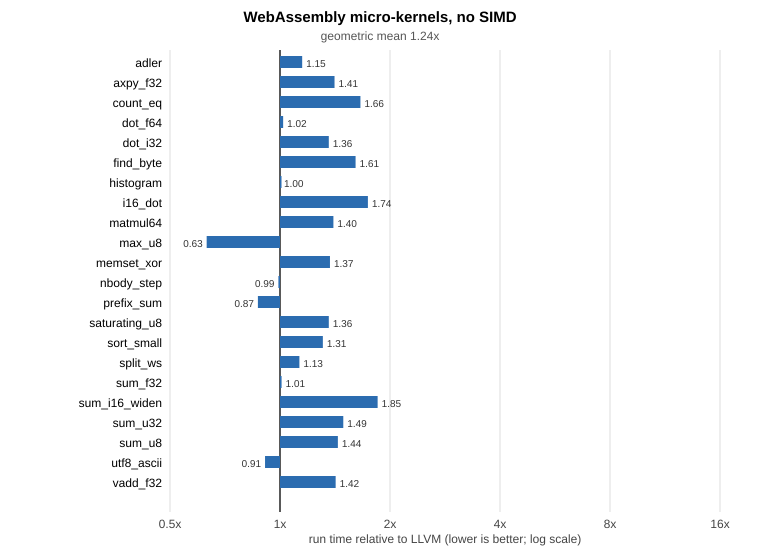
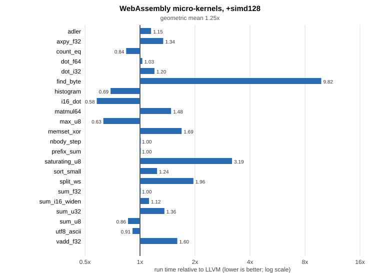
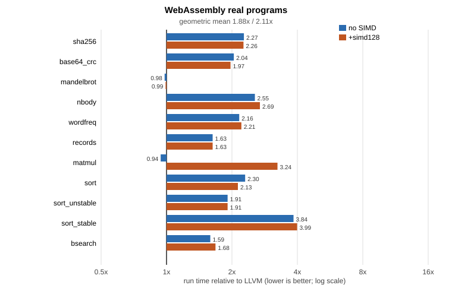
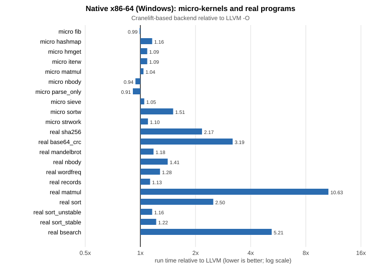
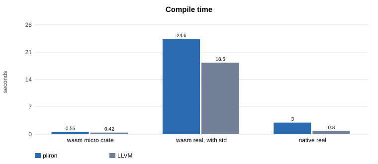
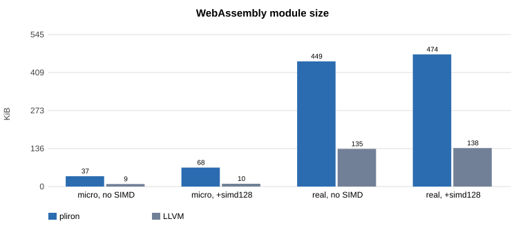

# The pliron backend compared with LLVM: WebAssembly and native performance

Date: 2026-10-13. Branch: `wasm-simd`. Written in ASD-STE100 Simplified Technical English.

## 1. Summary

This report compares the pliron backend with the LLVM backend of rustc.
Both backends compile the same Rust source with the same nightly compiler and the same flags.
We measure run time, compile time, and code size.

A ratio is the pliron value divided by the LLVM value. A ratio below 1.0 means that pliron is faster or smaller.

| Measurement | Before this work | After this work | Remark |
|---|---|---|---|
| WebAssembly micro-kernels, no SIMD, run time | 1.61x | **1.24x** | 22 kernels, geometric mean |
| WebAssembly micro-kernels, +simd128, run time | 2.68x | **1.25x** | LLVM auto-vectorizes. pliron did not vectorize before. |
| WebAssembly real programs, no SIMD, run time | 2.05x | **1.88x** | 11 programs now. The same 8 programs: 2.05x before, 1.75x now. |
| WebAssembly real programs, +simd128, run time | not measured | 2.11x | Matrix multiply and sorts are the weak points. |
| WebAssembly module size, real programs | not measured | 3.3x | See section 7. |
| Native x86-64 micro-kernels, run time | 1.0x | 1.08x | 10 kernels. Not changed by this work. Run to run noise is large. |
| Native x86-64 real programs, run time | not measured | 2.1x | One kernel is 12.9x slower. See section 5. |
| Compile time, wasm with std | not measured | 1.3x | 24.6 s against 18.5 s |
| Compile time, native | 2 to 3x | 3.8x | 3.0 s against 0.8 s for the real programs |

The main result is this: the WebAssembly path now vectorizes loops and uses simd128 instructions.
On the micro-kernels, the pliron output is about 1.2 times slower than LLVM output on average.
On real programs that use the standard library, it is about 1.9 times slower (2.1 times with SIMD).
The remaining gap is mostly in sorting, hashing and fully unrolled arithmetic loops.

## 2. How we measured

### 2.1 Machine and tools

- CPU: Intel Core i7-12700K, 12 cores, Windows 11.
- Rust: nightly 2026-10-06. The LLVM backend uses LLVM 23.1.3.
- WebAssembly engine: Node.js 24.21.0 (V8). Both modules run in the same process on the same machine.
- Native target: `x86_64-pc-windows-msvc`. The native standard library is the prebuilt one, compiled by LLVM.
- Build flags: `-O` (opt-level 3), `panic=abort`, `codegen-units` at the default value.
- WebAssembly standard library: built from source with `-Zbuild-std` by the backend under test.

### 2.2 Method

- Each kernel runs one warm-up call. Then we take the best of 5 timed calls.
- Each program returns a checksum. The test fails if the two backends return different checksums. All results here have 0 mismatches.
- The micro-kernels write one byte to every input array before each repetition. This stops LLVM from moving a whole kernel out of the repetition loop.
- Timing noise on this machine is up to 10 percent. Do not trust smaller differences.

### 2.3 Programs

The micro-kernels are in `tests/wasm/bench/lib.rs`. They are small loops over static arrays: sums, dot products, byte counts, saturating add, histogram, prefix sum, matrix multiply and others.

The real programs are in `tests/wasm/real/real.rs`. They are normal Rust code that uses `Vec`, `String`, `HashMap`, `format!`, `sort` and `parse`:

| Program | What it does |
|---|---|
| sha256 | SHA-256 of a 64 KiB buffer |
| base64_crc | Base64 encode and decode, then CRC-32 |
| mandelbrot | Mandelbrot set, `f64` |
| nbody | N-body simulation, `f64` |
| wordfreq | Count words with a `HashMap`, sort, format the top 50 |
| records | Format records as text, then parse them back |
| matmul | Matrix multiply, `f32` |
| sort, sort_unstable, sort_stable | Sort and search 50 000 integers |
| bsearch | Binary search |

## 3. WebAssembly micro-kernels



Without SIMD, the geometric mean is 1.24x. Seven kernels are within 5 percent of LLVM or faster.

| Kernel | pliron ms | LLVM ms | Ratio |
|---|---|---|---|
| adler | 121.62 | 105.46 | 1.15 |
| axpy_f32 | 5.46 | 3.87 | 1.41 |
| count_eq | 22.89 | 13.82 | 1.66 |
| dot_f64 | 5.32 | 5.21 | 1.02 |
| dot_i32 | 4.15 | 3.06 | 1.36 |
| find_byte | 5.95 | 3.70 | 1.61 |
| histogram | 17.01 | 16.95 | 1.00 |
| i16_dot | 4.77 | 2.74 | 1.74 |
| matmul64 | 353.53 | 253.22 | 1.40 |
| max_u8 | 15.41 | 24.31 | 0.63 |
| memset_xor | 12.95 | 9.45 | 1.37 |
| nbody_step | 10.64 | 10.73 | 0.99 |
| prefix_sum | 2.64 | 3.03 | 0.87 |
| saturating_u8 | 21.09 | 15.48 | 1.36 |
| sort_small | 0.94 | 0.72 | 1.31 |
| split_ws | 19.44 | 17.28 | 1.13 |
| sum_f32 | 5.28 | 5.25 | 1.01 |
| sum_i16_widen | 4.86 | 2.63 | 1.85 |
| sum_u32 | 3.91 | 2.63 | 1.49 |
| sum_u8 | 15.10 | 10.47 | 1.44 |
| utf8_ascii | 7.39 | 8.13 | 0.91 |
| vadd_f32 | 5.62 | 3.96 | 1.42 |

LLVM unrolls most integer loops by a larger factor than pliron does. This explains most of the 1.3x to 1.8x entries.



With `-Ctarget-feature=+simd128`, LLVM vectorizes loops. Before this work, the pliron backend did not.
The geometric mean fell from 2.68x to 1.25x.
Five kernels are now faster than LLVM: `count_eq`, `histogram`, `i16_dot`, `max_u8` and `sum_u8`.

| Kernel | pliron ms | LLVM ms | Ratio |
|---|---|---|---|
| adler | 121.32 | 105.46 | 1.15 |
| axpy_f32 | 1.15 | 0.86 | 1.34 |
| count_eq | 4.13 | 4.92 | **0.84** |
| dot_f64 | 5.34 | 5.19 | 1.03 |
| dot_i32 | 1.31 | 1.09 | 1.20 |
| find_byte | 5.92 | 0.60 | 9.82 |
| histogram | 11.72 | 17.07 | **0.69** |
| i16_dot | 2.06 | 3.57 | **0.58** |
| matmul64 | 370.52 | 249.73 | 1.48 |
| max_u8 | 15.40 | 24.55 | **0.63** |
| memset_xor | 1.27 | 0.75 | 1.69 |
| nbody_step | 10.66 | 10.65 | 1.00 |
| prefix_sum | 2.62 | 2.62 | 1.00 |
| saturating_u8 | 2.41 | 0.76 | 3.19 |
| sort_small | 0.93 | 0.76 | 1.24 |
| split_ws | 18.95 | 9.68 | 1.96 |
| sum_f32 | 5.14 | 5.13 | 1.00 |
| sum_i16_widen | 0.76 | 0.67 | 1.12 |
| sum_u32 | 0.91 | 0.66 | 1.36 |
| sum_u8 | 2.42 | 2.83 | **0.86** |
| utf8_ascii | 7.39 | 8.14 | 0.91 |
| vadd_f32 | 1.46 | 0.91 | 1.60 |

Two entries are worth a note.

- `find_byte` is 9.8x slower. The LLVM loop is about 10 times faster than its own scalar loop, so it probably vectorizes the early exit. The pliron vectorizer does not do this yet.
- `saturating_u8` is 3.2x slower. Both backends use the saturating instruction. We have not found the cause yet.

## 4. WebAssembly real programs



| Program | pliron ms | LLVM ms | Ratio, no SIMD | Ratio, +simd128 |
|---|---|---|---|---|
| sha256 | 6.55 | 2.88 | 2.27 | 2.26 |
| base64_crc | 18.52 | 9.08 | 2.04 | 1.97 |
| mandelbrot | 8.62 | 8.84 | 0.98 | 0.99 |
| nbody | 0.69 | 0.27 | 2.55 | 2.69 |
| wordfreq | 15.81 | 7.30 | 2.16 | 2.21 |
| records | 6.70 | 4.10 | 1.63 | 1.63 |
| matmul | 12.07 | 12.86 | 0.94 | 3.24 |
| sort | 27.34 | 11.89 | 2.30 | 2.13 |
| sort_unstable | 6.40 | 3.36 | 1.91 | 1.91 |
| sort_stable | 18.97 | 4.94 | 3.84 | 3.99 |
| bsearch | 5.35 | 3.37 | 1.59 | 1.68 |
| **geometric mean** | | | **1.88** | **2.11** |

The times in the first two data columns are for the build without SIMD.

Three results need an explanation.

1. **sha256 is 2.3x slower.** The most likely cause is full unrolling. LLVM can unroll the 64 rounds and keep the message schedule in registers. pliron keeps the schedule in memory.
2. **sort_stable is 3.8x slower.** The merge step of the standard library does many small copies and pointer picks. pliron now expands small copies, but the merge loop is still slow. We have not found the cause yet.
3. **matmul is 3.2x slower with SIMD.** Both backends vectorize the inner loop. LLVM is 7 times faster than its own scalar code. pliron is only 2 times faster than its own scalar code. We have not found the cause yet.

### 4.1 What fixed the first run

The first run of this suite had `sort` at 8.3x. We found three causes and fixed them in this work:

| Cause | Fix | Effect on `sort` |
|---|---|---|
| Small constant `memcpy` became a `memory.copy` instruction. V8 runs this instruction slowly. | Expand copies of 32 bytes or fewer into loads and stores. | 8.3x to 4.3x |
| Closures called in a hot loop were not inlined. | Raise the inline limit for loop call sites from 15 to 36 instructions. | 4.3x to 2.2x |
| Pointer picks like `if c { &a } else { &b }` kept stack slots in memory. | Turn the diamond into `select` and promote the slots to registers. | `bsearch` 6.1x to 3.6x, then 1.7x with the inline limit |

## 5. Native x86-64



The native results were not the target of this work. The same native code generator is in the repository head. We measured it to give a complete picture.

| Micro-kernel | LLVM ms | pliron ms | Ratio |
|---|---|---|---|
| fib | 6.902 | 6.834 | 0.99 |
| hashmap | 51.855 | 59.940 | 1.16 |
| hmget | 9.148 | 10.006 | 1.09 |
| iterw | 35.566 | 38.746 | 1.09 |
| matmul | 5.321 | 5.514 | 1.04 |
| nbody | 70.411 | 66.168 | 0.94 |
| parse_only | 292.030 | 264.880 | 0.91 |
| sieve | 13.947 | 14.693 | 1.05 |
| sortw | 5.044 | 7.638 | 1.51 |
| strwork | 11.783 | 12.903 | 1.10 |
| **geometric mean** | | | **1.08** |

| Real program | LLVM ms | pliron ms | Ratio |
|---|---|---|---|
| sha256 | 2.54 | 5.50 | 2.17 |
| base64_crc | 6.81 | 21.72 | 3.19 |
| mandelbrot | 8.59 | 10.17 | 1.18 |
| nbody | 0.22 | 0.31 | 1.41 |
| wordfreq | 6.62 | 8.46 | 1.28 |
| records | 7.48 | 8.44 | 1.13 |
| matmul | 1.56 | 16.58 | 10.63 |
| sort | 9.33 | 23.33 | 2.50 |
| sort_unstable | 3.23 | 3.76 | 1.16 |
| sort_stable | 4.12 | 5.04 | 1.22 |
| bsearch | 1.73 | 9.01 | 5.21 |
| **geometric mean** | | | **2.09** |

The micro-kernels in `bench/` are at parity. The real programs show larger gaps.

- **matmul is 12.9x slower.** The inner loop `out[j] += a * row[j]` works on two slices that the compiler cannot prove to be separate. The probable cause is that the native loop vectorizer needs this proof. The WebAssembly vectorizer adds a runtime overlap check instead. We recommend the same change for the native vectorizer. We did not verify this.
- **sha256 and base64_crc are 3.6x slower.** Both are byte and word loops with table lookups and rotates. We have not analyzed them.
- **bsearch is 5.1x slower.** The standard library binary search is written to use conditional moves. We have not analyzed the native code for it.

## 6. Compile time



| Build | pliron | LLVM | Ratio |
|---|---|---|---|
| WebAssembly micro crate (core prebuilt) | 0.55 s | 0.42 s | 1.3x |
| WebAssembly real program, std built from source | 24.6 s | 18.5 s | 1.3x |
| WebAssembly real program, +simd128 | 23.4 s | 19.0 s | 1.2x |
| Native real program (prebuilt std) | 3.0 s | 0.8 s | 3.8x |

The WebAssembly path is close to LLVM in compile time. The native path is slower because it runs a long pipeline of Cranelift IR passes.

## 7. Code size



| Module | pliron | LLVM | Ratio |
|---|---|---|---|
| Micro crate, no SIMD | 38 124 B | 10 077 B | 3.8x |
| Micro crate, +simd128 | 70 491 B | 10 861 B | 6.5x |
| Real program, no SIMD | 460 457 B | 138 286 B | 3.3x |
| Real program, +simd128 | 485 543 B | 142 139 B | 3.4x |
| Native real program (`.exe`) | 402 432 B | 250 368 B | 1.6x |

The modules are about 3 times larger than the LLVM modules. The pliron output of the real program has 476 functions. The LLVM output has 195. There are three known causes.

1. **Loop unrolling.** The default factor is 8. The setting `PLIRON_WASM_UNROLL=2` makes the micro crate 33 percent smaller and about 5 percent slower.
2. **Vectorizer copies.** Each vectorized loop has a vector loop, a second vector loop and the original scalar loop. LLVM emits a vector loop and a scalar remainder.
3. **No cross-unit inlining.** The standard library is split into many code units. LLVM runs thin local LTO and inlines between them. pliron inlines only inside one unit. Many small helper functions stay as separate copies.

We tried `-Ccodegen-units=1`. The module became larger (1.0 MB), because the linker keeps more code. We do not recommend it.

## 8. What changed in this work

All changes are in the WebAssembly path (`src/wasm.rs` and `src/wasm/`) unless noted.

| Change | Purpose |
|---|---|
| simd128 lowering of native vectors, lane operations, shuffles, casts and `llvm.wasm.*` intrinsics | Correct and fast explicit SIMD. Vectors are lane-flattened when `simd128` is off. |
| Loop vectorizer (`src/wasm/vec.rs`) | Unit-stride loops, reductions, widening and narrowing, 4x unroll, runtime overlap check |
| Scalar simplifier (`src/wasm/simp.rs`) | Constant folding, algebra, value numbering, known-condition folding, jump threading, block merging, select diamonds |
| Frame-slot promotion (`src/wasm/mem2reg.rs`) | Move address-taken stack slots to SSA values after inlining |
| Loop optimizations run after inlining | Loops see the inlined iterator code |
| Small `memcpy`/`memmove`/`memset` expansion | Avoid slow bulk-memory instructions |
| Inline limits | Hot call sites inline up to 36 instructions |
| Tests | `tests/wasm/simd.sh`, `bench.sh`, `real.sh`, `fuzz.sh` |

One older bug was found and fixed with the real-program suite. When the inliner put a function with a stack frame into a caller that had one block and no frame, the new stack reservation looked like a restore. The stack pointer then leaked 32 bytes per call, and a program trapped after many calls.

The test suites all pass:

- `tests/wasm/run.sh`: core, std, WASI (the filesystem leg is skipped on Windows), unwinding.
- `tests/wasm/simd.sh`: about 40 SIMD test calls compared with LLVM.
- `tests/wasm/fuzz.sh`: random loop kernels of 8 integer types and 2 float types, 13 loop shapes, compared with LLVM on 13 sizes. More than 1000 kernels ran with 0 mismatches, in both SIMD and scalar mode.

## 9. Known problems and next steps

1. **Fully unrolled loops.** Add full unrolling of loops with a small constant trip count, and promotion of small constant-size arrays. This is the main cause of the `sha256` gap.
2. **Early-exit vectorization.** Needed for `find_byte`, `position`, `any` and `all`.
3. **Cross-unit inlining.** Inline between code units at link time. This reduces size and run time.
4. **Native vectorizer.** Add the runtime overlap check. This should fix the 12.9x `matmul` result.
5. **Code size.** Choose an unroll factor from the loop size. The dead-code pass made inlining more eager and the modules 9 percent larger.

## 10. How to repeat these measurements

```
cargo build
bash tests/wasm/bench.sh 3000            # micro-kernels, no SIMD
bash tests/wasm/bench.sh --simd 3000     # micro-kernels, +simd128
bash tests/wasm/real.sh                  # real programs: wasm and native
bash tests/wasm/real.sh --simd --wasm-only
bash bench/run.sh 5                      # native micro-kernels
bash tests/wasm/fuzz.sh 1 80             # differential loop fuzzer
python docs/perf/charts.py               # redraw the charts
```

The raw output files are in `docs/perf/`. The tool `tools/wfn.py` prints one exported function as text for code review.
