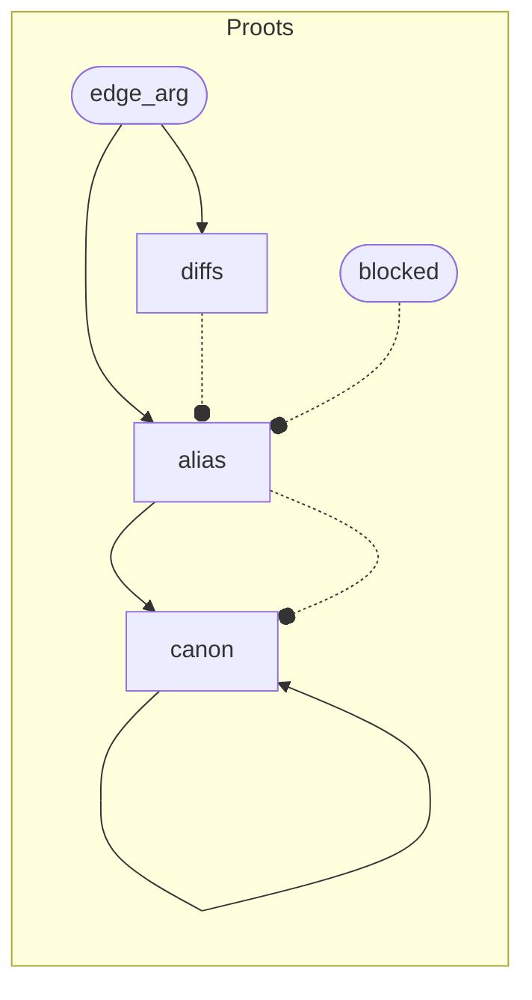
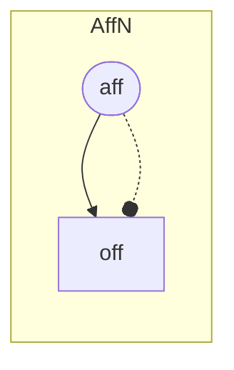
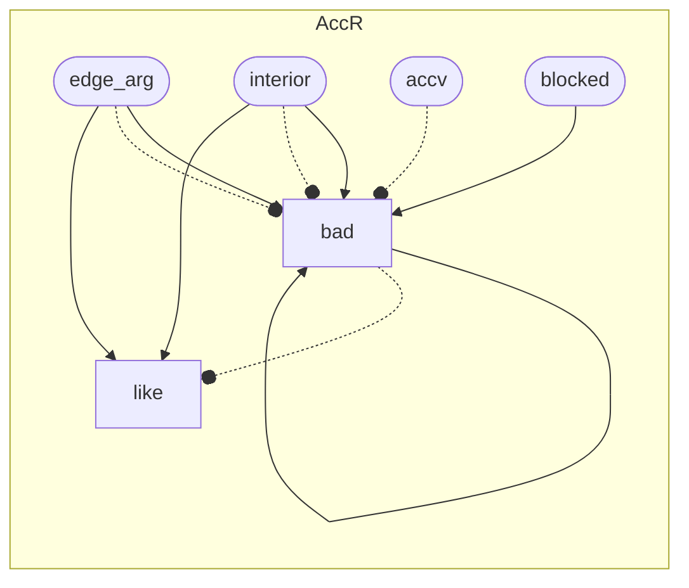
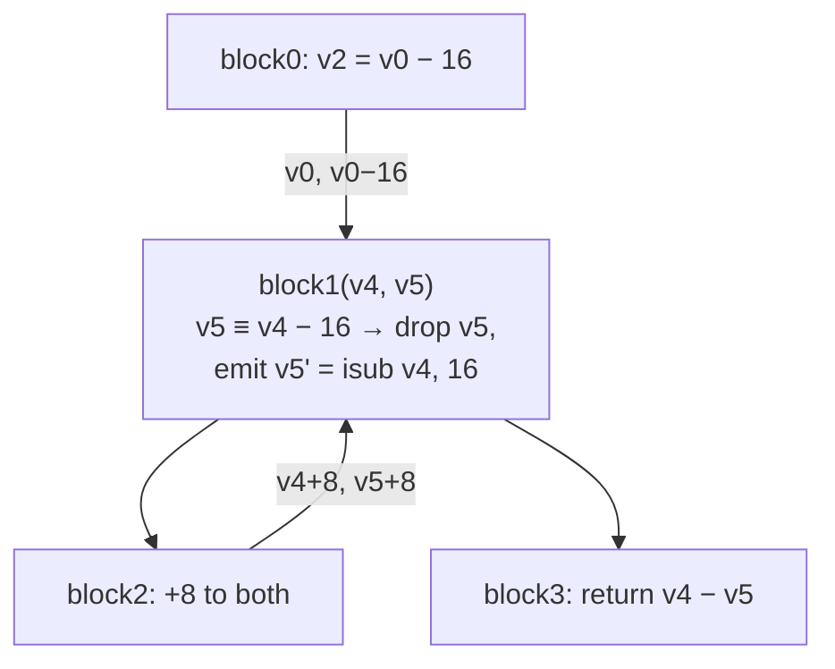

# One question, many answers: the phi-web engine in pliron-clif-opt

This note explains the param-web machinery in `pliron-clif-opt`. It
shows how one shared question replaced six specialized passes, and how
the Ascent Datalog engine makes the answers cheap to write.

## The problem

Many optimizer passes ask the same question about a block parameter:
what value arrives in this slot on each incoming edge? Six passes used
to answer it by hand. Each pass walked the CFG, matched branch
arguments, chased aliases, and guarded against cycles on its own.

Each hand-rolled version had its own bugs. Cycle guards differed per
pass. Recursion depth limits caused false negatives. A fix in one pass
did not help the others.

The passes were:

- `param_src` — a param that every edge feeds the same value is that
  value.
- `sameargs` — two param slots that agree on every edge can merge.
- `cparm` — a param that chases to a constant can fold.
- `relparm` — two params a constant step apart can merge.
- `arghoist` — an arg computed the same way on every edge can lift to
  the header.
- `AccCx::is_acc` — a param that always carries the loop accumulator.

## The fact table

`proots::facts` answers the mechanical part once. One CFG walk records
three things:

- `edge` — `(param, arg)` on every reachable incoming edge.
- `blocked` — params fed a non-`Value` arg, opaque to every query.
- `detail` — per-param tuples `(terminator, slot, source block, arg)`.

Two choices make the table safe to query. First, extraction resolves
aliases on every arg. Second, it drops self-carry edges. A self-carry
edge passes the param back unchanged. It contributes no fact, so it
can neither prove nor disprove a query.

Every consumer reads the same table. A fix to extraction fixes every
query.

## Three small Datalog programs

The queries are Ascent programs. Each declares input relations and
derives new ones by monotone rules. `tools/ascent_viz.py` generates
these graphs from the source.

`Proots` derives the uniform-source relation. `diffs` marks a param fed
two different values. `alias` holds when every edge agrees.
`canon` chases uniform sources transitively to the web's root.



`alias(p, a)` is `param_src`. `canon(p, r)` is the transitive chase
that `sameargs` and `cparm` each implemented by hand.

`AffN` collapses `iadd`/`isub`-by-constant chains. `aff(v, m, k)` reads
"`v` is `m + k`". `off(v, r, k)` is the transitive closure: `v` is
`root + k` where `r` is not itself an affine step.



`AccR` answers "does this param always carry `acc`" for loopvec.
`bad` marks a param fed a non-`acc` value, an opaque arg, or an
already-`bad` param. `like` is what remains.



## Why Ascent helps

The rules are the specification. `alias(p, a) <-- edge_arg(p, a),
!diffs(p), !blocked(p)` says "every edge agrees" in one line. The
engine orders the rules, runs them to fixpoint, and keeps them

Stratified negation does the real work. `!diffs(p)` is legal because
`diffs` derives fully before `alias` reads it. The same pattern in
`AccR` — `bad` before `like` — replaces a recursive `is_acc` that had
a hand-set depth bound and phi-cycle false negatives. Both problems
disappear because the fixpoint is exact, not bounded.

## The part Ascent cannot express

`web_nf` lifts `off` through params. A param whose edges all deliver
`root + k` *is* `root + k` at its block's entry, so it takes that
class too. A downstream edge that passes the param then keys through
the class. That is what makes congruence multi-hop.

"All edges agree" over a relation that is still growing is negation
through recursion. Ascent forbids it. Worse, the step is not even
monotone: an unclassified arg reads as its own leaf `(a, 0)`,
and classifying it later changes what it contributed. A relation
cannot retract a premature disagreement.

So `web_nf` runs as a Rust loop. Each round re-evaluates uniformity
against the current table instead of freezing it. This is not a
workaround for a missing feature. The loop *is* the stratification —
each iteration is a stratum boundary.

## One merge engine

The classes feed `key_of`, which gives every value a structural key:
`V` for opaque leaves, `K` for materializable constants, `A` for
affine normal forms, `N` for pure operations keyed on their operands'
keys. `paramize` adds `P(i)` and `Q(i)` leaves — "the value in slot
`i`" — so a back-edge arg like `p_j + 8` keys as a function of the
params it came from.

`webmerge` merges params and edge args whose keys agree. Where a
dropped param is still needed, it materializes the difference as an
`iadd` or `isub` at the header.

The filetest `webmerge_relparm.clif` shows the whole pipeline on one
loop:

```text
block0(v0):            entry: v2 = v0 - 16
    jump block1(v0, v2)
block1(v4, v5):        header: v5 ≡ v4 - 16 on both edges
    brif exit, block3, block2
block2:                latch: steps both params by +8
    jump block1(v4+8, v5+8)
block3:                exit: reads v4 - v5
    return v4 - v5
```



On entry, `v5` is `v4 - 16`. On the back edge, `v5 + 8` keys as
`(v4 + 8) - 16`, still the same class. The gap is loop-invariant, so
`v5` drops out of the header's param list. The old `relparm` pass had
a dedicated matcher for exactly this shape. Now it is one row in the
web.

## What it replaced and what it costs

Six passes now share one engine at a few pipeline positions. The
deleted matchers were the hard part of `phimerge`, `affparm`,
`relparm`, `arghoist`, `sameargs_round`, and `cparm_round` — roughly a
thousand lines of per-pass machinery.

Correctness travels with the merges. When `pmap[d] = w` drops `d`, the
pipeline carries `d`'s facts — nonnull, deref, frozen — to `w`. The
merge itself proves `w` has `d`'s value on every path, so the carry is
sound for every merge kind.

The engineering cost went to representation, not rules. Deep key
clones became `Rc` children. Per-node subtree hashing became a
pointer-keyed memo. Structural equality checks became hash guards. On
the hot hashmap CGU the whole web family costs about 12 ms of a 180 ms
pipeline, down from about 1 s across seven call sites.

## What remains

- Inst-keyed facts do not ride the value-alias carry yet.
- The step cache replays `func` and `derived` but not carried facts.

*Diagrams regenerate with `python3 tools/ascent_viz.py`.*
